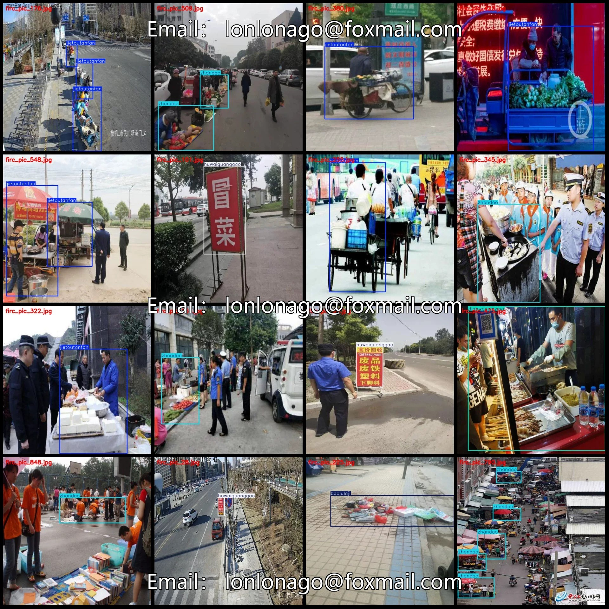
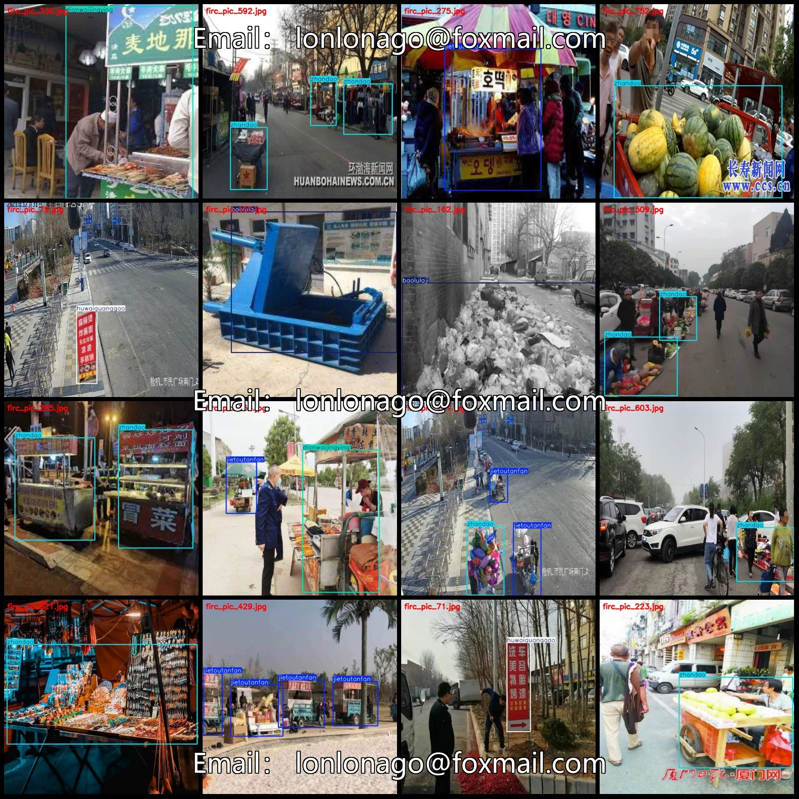
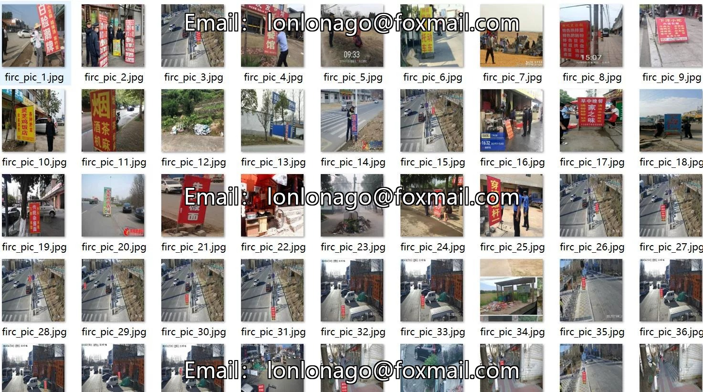
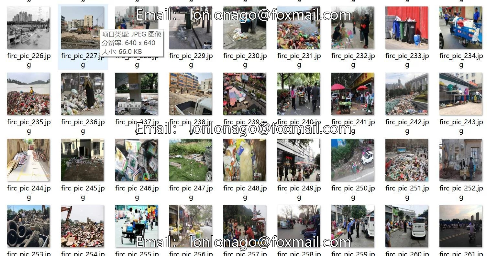
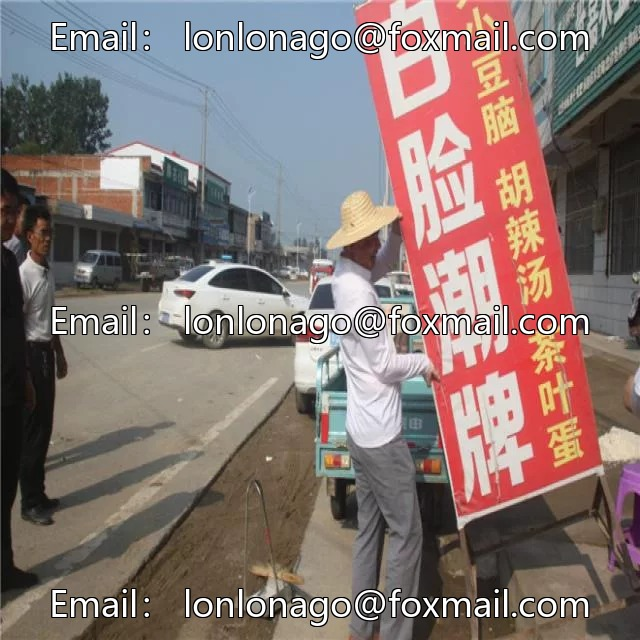
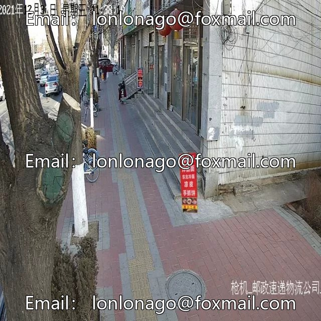

# Urban Management Street Management Obstructing Traffic Signs Garbage Shops Out-of-Street Business Detection Data Set VOC+YOLO Grid

## Body

Marketing and Traffic Management Street-Side Management, Advertising, Garbage Shops Off-Street Business Detection Data Set VOC+YOLO Format 856 Categories
Warm Reminder: Due to the dataset's replicability, please confirm compliance with requirements before purchasing.
Dataset Format: Pascal VOC format + YOLO format (txt file without split path, only containing jpg images along with corresponding VOC format xml files and yolo format txt files)
Number of Images (Total jpg files): 856
Number of Annotations (Total xml files): 856
Number of Annotations (Total txt files): 856
Number of Annotation Categories: 5

Annotation categories: ["baolulaji", "dianwaijingying", "huwaiguanggao", "jietoutanfan", "zhandao"]
Corresponding Chinese category names: ["exposed trash", "outside the store", "outdoor advertising", "street vendors", "traffic obstruction"]
Number of boxes per category and number of images occupied by each category:
- baolulaji: 117 boxes, 104 images
- dianwaijingying: 178 boxes, 149 images

Huwaiguanggao: Frames = 175, Image Count = 123
Jietoutanfan: Frames = 233, Image Count = 178
Zhandao: Frames = 476, Image Count = 379
Total Frames: 1179
Image Resolution: 640x640
Labeling Tool: labelImg
Labeling Rules: Draw a rectangle around the category.
Important Notice: The dataset does not have splits for training, validation, or testing; you need to manually divide it.
Special Remark: This dataset does not guarantee the accuracy of the trained models or weight files.

## Images

## Payment

Here is a pay link on Stripe ( https://buy.stripe.com/3cs8yP7sY87d0vu9AB ). Please contact me lonlonago@foxmail.com after funding $89, and I will send you a complete data files , thank you!

